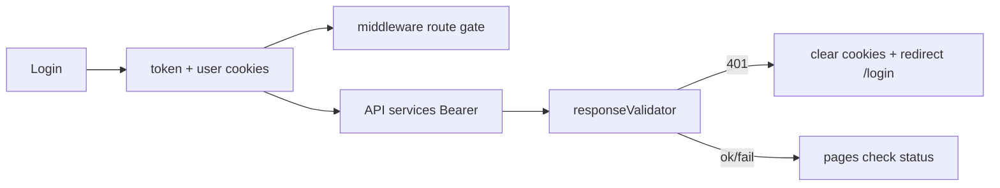

# Frontend Production Hardening

Scope: **frontend-only** fixes. Backend still owns real authz; HttpOnly sessions / JWT edge validation are documented follow-ups, not in this pass.

Default for API URL: introduce `NEXT_PUBLIC_API_URL` with fallback to the current production URL so existing deploys keep working.

## Todos

- [ ] Fix `canView`/`canEdit`, `isSuperAdmin` derivation, login user cookie shape, cookie Secure/SameSite, middleware user-required
- [ ] 401 clear+redirect; `NEXT_PUBLIC_API_URL` + `.env.example`; encode query params
- [ ] Mutation status checks; role-management crash; Table empty state + remove `console.log`
- [ ] Image hosts, security headers, HTML sanitize, remove hello API
- [ ] ESLint setup, strip debug logs, remember-me fix, README, verify build

## 1. Auth / permission correctness (critical)

- Fix [`src/utils/helpers.js`](src/utils/helpers.js) `canView` / `canEdit`: deny when `!user`; allow-all only when `user.isSuperAdmin` (or `roleType === "SUPER"`).
- Fix [`src/services/api/cookies.js`](src/services/api/cookies.js) `getUser`: derive `isSuperAdmin` from `roleType === "SUPER"` only (not empty `adminPermission`).
- On login in [`src/pages/login/index.jsx`](src/pages/login/index.jsx): store a **stripped** user object (no nested token); keep token only in `token` cookie.
- Cookie flags: add `secure: true` (production), `sameSite: "strict"` on set/remove in [`cookies.js`](src/services/api/cookies.js).
- Middleware ([`src/middleware.js`](src/middleware.js)): if `token` exists but `user` cookie is missing/invalid → clear and redirect to `/login`; require valid user for permission checks on all protected routes.

## 2. Session expiry + API client

- In [`src/services/api/helper.js`](src/services/api/helper.js) 401 branch: clear token/user cookies and redirect to `/login` (reuse logout path / `setLoggingOut`).
- Move base URL to `process.env.NEXT_PUBLIC_API_URL` with fallback `https://api.investwithyanci.com/v1/`.
- Add [`.env.example`](.env.example); update [`.gitignore`](.gitignore) to ignore `.env` (not only `.env*.local`).
- Encode query params in services that interpolate search strings (e.g. withdrawal/support).

## 3. Mutation / fetch reliability (high-impact call sites)

- Guard success before UI side-effects: KYC approve/reject ([`src/pages/index.js`](src/pages/index.js), [`src/pages/kyc/index.jsx`](src/pages/kyc/index.jsx)), user delete ([`src/pages/user/[userId]/index.jsx`](src/pages/user/[userId]/index.jsx)), dropdown actions in [`src/config/dropdownConfig.js`](src/config/dropdownConfig.js).
- Fix role-management crash on failed fetch ([`src/pages/role-management/index.jsx`](src/pages/role-management/index.jsx)): never spread undefined; always clear `loading`.
- Add empty-state row to shared [`src/components/table/Table.jsx`](src/components/table/Table.jsx); remove hot-path `console.log`.

## 4. Security / config hygiene

- Tighten [`next.config.mjs`](next.config.mjs) `images.remotePatterns` to known hosts (API/CDN for Yanci assets — use `api.investwithyanci.com` and any current image host used in UI).
- Add security headers in `next.config.mjs` (at least `X-Frame-Options`, `X-Content-Type-Options`, `Referrer-Policy`, basic `Content-Security-Policy` compatible with existing Toast/Jodit).
- Sanitize HTML before `html-react-parser` on policies/blog preview (add `dompurify` or equivalent).
- Remove dead [`src/pages/api/hello.js`](src/pages/api/hello.js); leave unused `registerSuperAdmin` export but do not wire it (note in README: confirm backend disables open registration).

## 5. Tooling / ship checklist

- Add `eslint` + `eslint-config-next` so `npm run lint` is non-interactive.
- Strip leftover debug `console.log` in cookies, Table, dropdownConfig, role-management, policies, support pages.
- Fix login “Remember me” controlled state mismatch (`expiry` vs `fields.expiry`) in [`src/pages/login/index.jsx`](src/pages/login/index.jsx).
- Update [`README.md`](README.md) with run/env/deploy notes (not stock create-next-app text).
- Verify with `npm run build` after changes.

## Out of scope (document only)

- HttpOnly cookies / server session revoke
- JWT validation inside middleware
- Next major upgrade (14 → 16)
- Wiring incomplete payout UI (`initiatePayout`)
- Full TypeScript migration / test suite / CI

## Success criteria

- Privilege helpers never grant access when user is missing
- Expired API sessions force logout + redirect
- API URL configurable via env
- `npm run lint` and `npm run build` succeed
- No optimistic “success” UI on failed mutations at the call sites listed above
